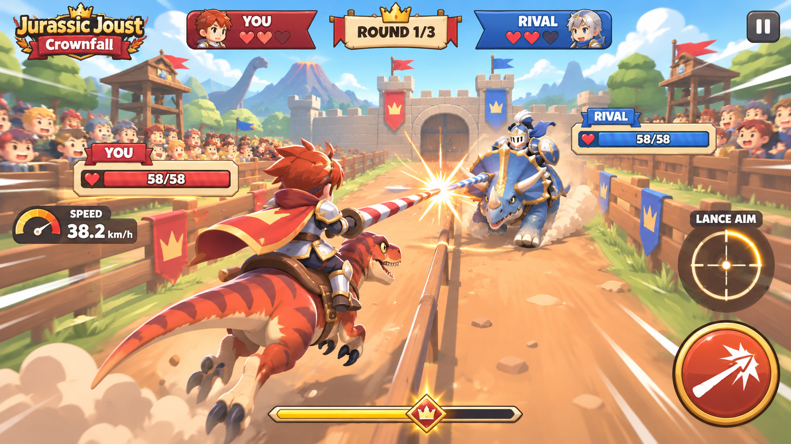
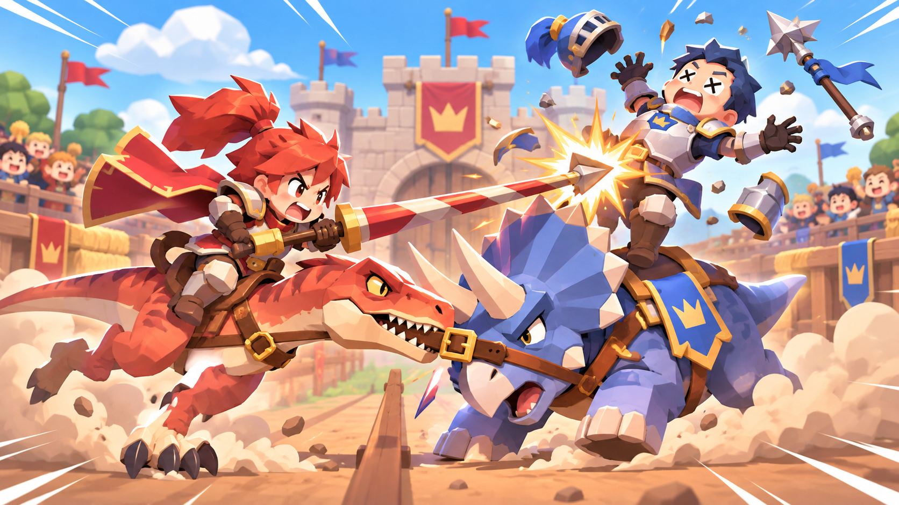
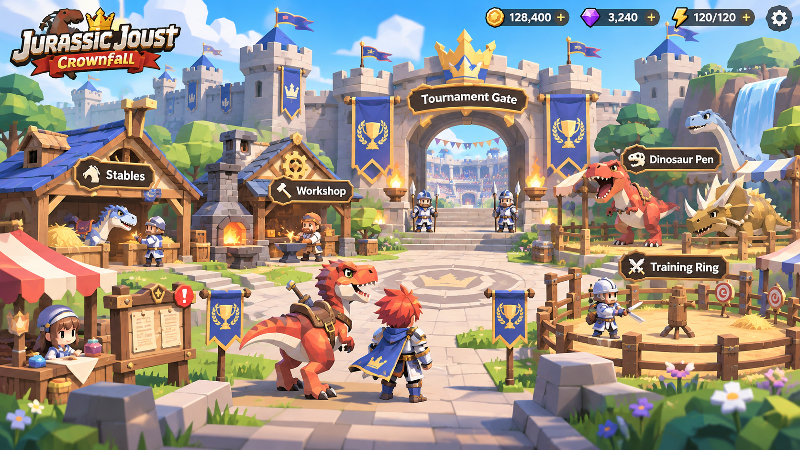
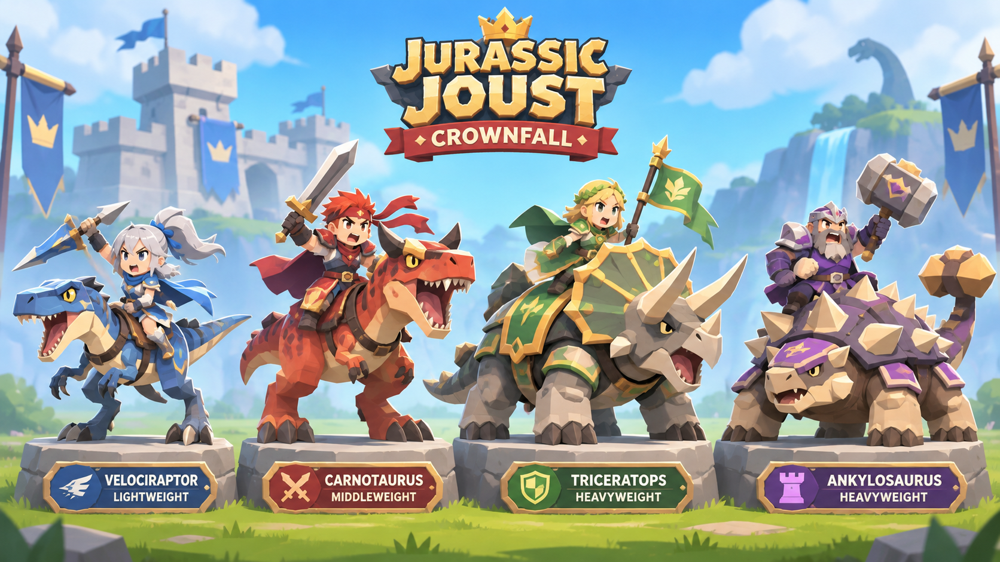

# Jurassic Joust: Crownfall

**Playable test branch** · Godot 4.6.3 · Windows x64, Linux x64 and WebGL 2

> **Pitch:** Ride a stylized dinosaur into compact medieval jousting tournaments. Win with a combination of rider lance skill, your dinosaur's natural combat instincts, terrain reading, and momentum. Dramatic ragdoll reactions are the reward, not the scoring engine.

## Play the exhibition

Ride the Ember Knight’s Velociraptor against the Azure Warden’s Protoceratops. Choose Royal Stone for fast acceleration or Rainsoft Clay for a slower charge. Unseat the rival to win immediately. Riders who stay mounted go to lance points after three passes, with one sudden-death pass for a tie.

Open `game/project.godot` in Godot 4.6.3 and press **F6** with the arena open, or **F5** from anywhere in the project. From a shell in the repository root:

```sh
godot --headless --path game --editor --import
godot --path game
```

| Action | Desktop | Landscape touch |
|---|---|---|
| Guide the mount | A / D or left / right arrows | Drag the bottom-left reins sideways |
| Gallop / coast | Hold / release W, ↑ or Space | Push the reins forward for more speed, lift to coast |
| Lower and aim the lance | Hold the left mouse button on the rider’s marked shield | Press the shield ring and follow it as the rival moves |
| Strike / raise | Keep aiming through the pass to strike, release to raise | Hold through contact, lift to raise |
| Pause | Escape | Pause button |

The mount trots automatically. For a first pass, leave the reins alone and follow the rival’s shield with one finger. The reticle turns green inside the shield. A clean hit earns two lance points, a glance earns one. Between about 19 and 32 km/h the raptor can snap at the rival’s harness. A braced frill absorbs part of that hit. The pass summary shows both strikes, both mount actions, speed and seat loss.

See [build steps, replay checks and prototype limits](game/README.md). Windows and web packages are also produced by the [test-build workflow](https://github.com/LoiHQ21/DinoJoust/actions/workflows/joust-build.yml).

## Design handoff

1. Read [`AGENTS.md`](AGENTS.md) before running Codex. It establishes project rules and prevents accidental scope creep.
2. Read [`docs/handoff/START_HERE.md`](docs/handoff/START_HERE.md) for current status and the next task.
3. Use [`docs/design/GDD_v0.3.md`](docs/design/GDD_v0.3.md) as the **canonical living GDD**. It supersedes the archived v0.2 draft where they conflict.
4. Verify the latest visual look using the four concepts below and [`docs/design/ART_BIBLE.md`](docs/design/ART_BIBLE.md).
5. Start with the first task in [`docs/production/ROADMAP.md`](docs/production/ROADMAP.md); do not implement everything simultaneously.

## Canonical visual references (AI concept art, not 3D model files)

| Live chase camera | Rider + dinosaur impact | 3D hub | Riders + mounts |
|---|---|---|---|
|  |  |  |  |

The current visual target is **original faceted chibi-anime fantasy 3D**: readable low-to-mid-poly meshes, angular/beveled armor, bold color blocking, expressive riders, dinosaur anatomy that still reads instantly, friendly tournament pageantry. It **replaces** earlier rounded Kingshot-inspired art direction, while retaining accessibility and asset economy.

**Camera:** live jousting uses a rear three-quarter **chase view** looking down the lane (not the former side-on view). A very brief impact emphasis and skippable follow-through/replay can use other angles **after input commit or after resolution**. This must work on PC and mobile in **landscape**.

## Deliverables already in this repo

- Canonical design docs, decision register, systems/specs, constraints, open questions
- Codex instructions and concrete first implementation task
- Structured *illustrative* JSON data with schema validation script
- User-confirmed art/camera references plus earlier concept generations preserved in archive
- An earlier GIF **concept only**, not real-time game-engine footage
- Archived original GDD v0.2 (Markdown and Word) for traceability
- Task backlog and GitHub issue templates

## Test-branch engine choice

Godot 4.6.3 with its Compatibility renderer is the engine for this exhibition. It supports a native desktop build and a single-thread WebGL build for landscape phones. The production engine choice and the larger GDD roadmap remain open. The test scene builds its animated meshes and scenery at runtime.

## Repository usage

This folder can be extracted and pushed to a new GitHub repository. See [`docs/handoff/GITHUB_SETUP.md`](docs/handoff/GITHUB_SETUP.md). Source art supplied as screenshots of other games/ads is intentionally **not bundled**; only our generated concepts are included.

There is no license granted by this repo. Choose a license for code and separately review rights/terms for generated assets before public redistribution or commercial use.
