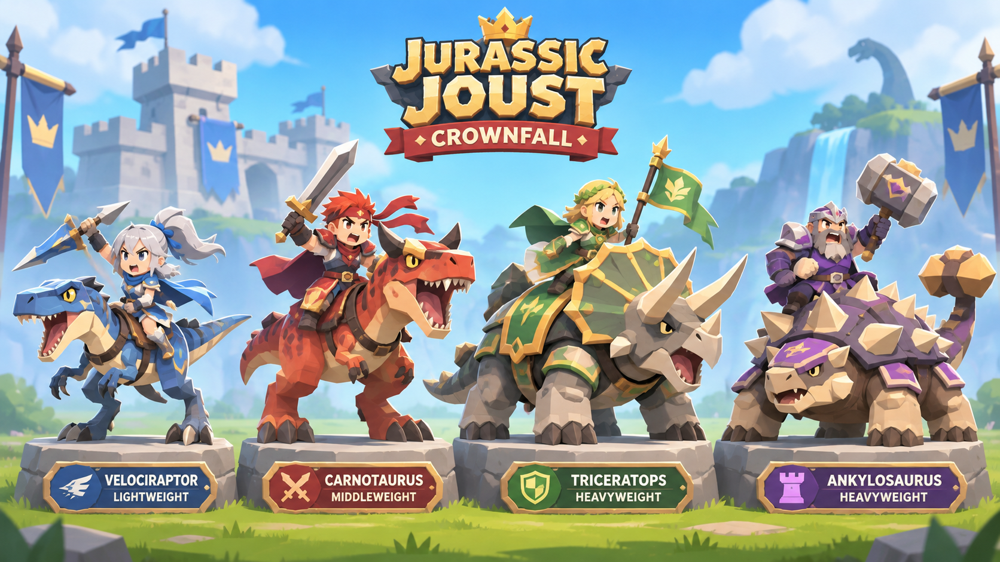
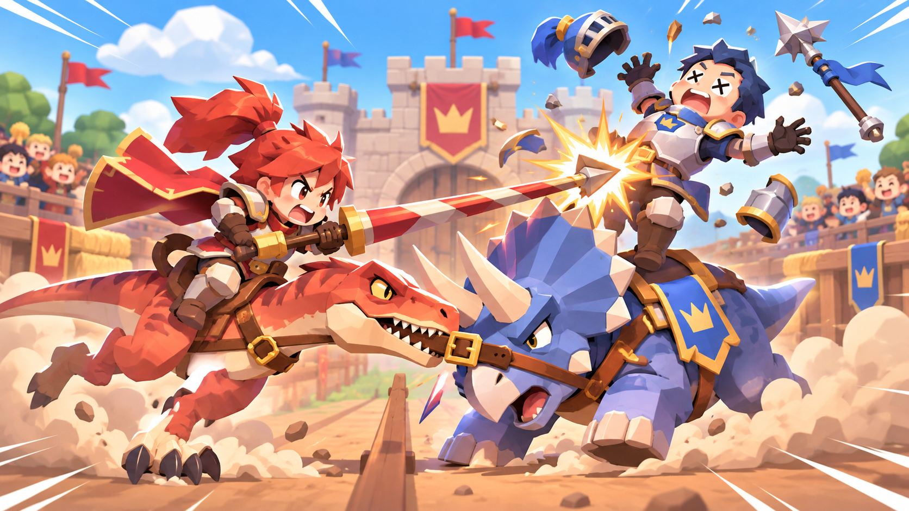

# Crownfall art bible — current direction

## Locked target

**Original faceted chibi-anime fantasy 3D**, influenced by a supplied Japanese fantasy roster screenshot rather than the earlier soft/rounded Kingshot-like game illustration. Design should be easy to author and reuse in Blender or an AI-to-3D-assisted workflow. These are real **mesh-based 3D models** with rigs, not images/billboards.

| Attribute | Do | Avoid |
|---|---|---|
| Proportions | Expressive chibi riders, enlarged heads/hair crests, legible armor silhouettes | Realistic soldiers or plush spherical faces |
| Shapes | Angular and faceted planes, selective beveled edges, designed chunky armor plates | Cubes/voxels or high-frequency detail |
| Dinosaurs | Raptor, ceratopsian, ankylosaur and other recognizable dinosaur silhouettes/gaits | Identical lizards in different colors; impossible four-legged raptors |
| Surface | Hand-painted gradients, controlled palette blocks, stylized metal highlights | Photoreal scaly microtexture, dozens of roughness maps |
| Color | Distinct heroic faction color pairs (red/cream/gold vs blue/white/gold etc.) | Murky palettes and saturated clutter over the contact zone |
| Environment | Modular castle walls, banners, fences, tournament stands, reusable ground kits | Whole new open world for every arena |
| VFX | Chunky dust, graphic starburst, cartoon wood splinters, expressive comic recoil | Gore, obscuring particle chaos, permanent screen shake |
| Animation | Broad readable preparation poses, strong timing and silhouette | Untelegraphed beast attack or jarring cuts during aim |

## Candidate standardized character kit

**Knight rig:** 1 main chibi rig with unified socket naming; interchangeable head/hair/helm, chest plate, shoulder plates, gauntlets, boots, crest, cape, shield, saddle, lance.

**Mount rig families:** lightweight biped, middle biped, squat ceratopsian, armored low quadruped. Share animation logic wherever possible but don't sacrifice bone/mesh anatomy differences; prototype rig compatibility before promising full retargeting.

**Rider-to-mount integration:** saddle attachment point, pelvis/leg IK or pose adjustments, rider lean from lance recoil, ragdoll detach moment, lance origin/aim pivot, front foot/root motion contact consistency.

## Art targets (prototype, unverified)

- Riders roughly 2.5–3.5 heads tall; test against chase camera occlusion.
- Mount triangles roughly 3k–8k Light, 6k–12k Heavy; use LODs/atlases after profiling.
- 512–1024px shared texture atlas slots for hero assets; favor palette masks and material reuse.
- Low-cost directional light + ambient fill + contact shadow, baked scenery where possible.
- Only one species first before mass-generating armor/variants; check small screen silhouette with no HUD.

## Key references

## Approval gates

1. Sides/front/back turnarounds agree on geometry and saddle interface; no hidden anatomical inconsistencies.
2. Raw 3D model survives import, triangulation, retopo, UV, rig, simple locomotion, aim and contact action in engine.
3. Full battle scene at 1280×720 remains readable with HUD, moving cameras and low-tier shadows.
4. A single model can be recolored and equipped with 2 variants without building it again.
5. No copied third-party IP, logos, copyrighted characters, or third-party screenshots shipped as models/textures.

## Current-versus-archived art

- `assets/concepts/current`: newest reference set, **source of art direction**.
- `assets/concepts/archive_kingshot`: softer round-toy look, useful for production simplicity only.
- `assets/concepts/archive_early`: early semi-real or presentation boards; archival, not instructions.

**Concept art may contain decorative UI, impossible armor attachments or noncanonical weight classes. Follow written specs, not AI-added image details.**
