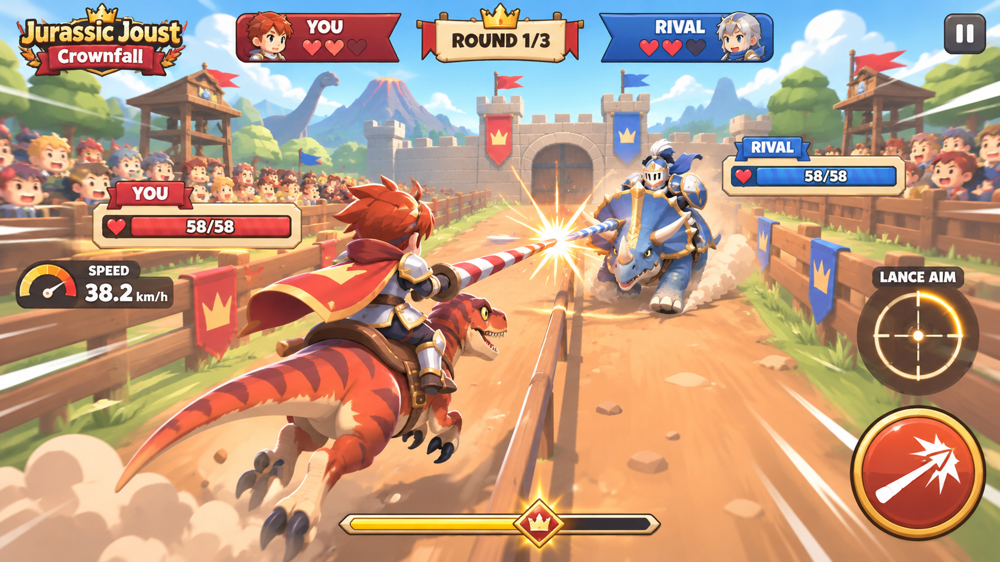

# Camera and screen UX contract

## Locked in-match camera: 3D over-the-rider chase

Source: later user-supplied portrait screenshots of a knight joust. Implement in **landscape**, do not copy the portrait game UI or branding.

**Framing:** behind-and-above the rider, lateral shoulder offset; the player/rider occupies bottom-left/lower-middle while oncoming opponent is visible down the corridor. Strong fence perspective lines, crowd parallax, trailing dust and speed cues. No steering; lane trajectories are guided.

### Live camera stages

1. `CHASE`: follows player mount at a readable distance/height, consistent target and lance projection.
2. `FOCUS`: mild zoom/FOV as opponent approaches; **must not alter perceived lance-to-target relationship** mid-gesture.
3. `CONTACT`: optional micro hit-stop once commit has occurred, contact point highlighted with separate rider/dinosaur cues.
4. `FOLLOW_THROUGH`: after verdict, cinematic alternate view for airborne ragdolls, armor shards, dino recoil; return on reset.

### Live camera hazards

- Mount head/tail blocks the opponent: shoulder-offset and aim target markers.
- Large helmets, flags, and UI cover the lance tip: keep a center safe region.
- Horn-to-horn or bite collision hidden by frill: on-contact cue and skippable replay from profile.
- Dynamic zoom makes aiming unpredictable: keep camera fixed for final 0.5–1.0 second.
- Exaggerated recoil makes players sick: optional reduced motion, camera shake defaults restrained.

## Camera by mode

| Mode/screen | Outside combat | In combat |
|---|---|---|
| Campaign | Elevated 3D castle tournament courtyard, fixed isometric-like 3/4, interactive hotspots | Shared chase |
| Challenge | 3D mini preview stage/target scenario, front three-quarter orbit | Shared chase plus teaching overlays |
| Draft | 3D rider/dino turntable in center, 2D deck/cards and bracket route | Shared chase |
| Endless | High arena sweep between matches, escalating lighting/weather | Shared chase |
| Exhibition | Two comparably scaled 3D rotating plinths; size and legality warnings | Shared chase, optional replay spectator orbit |
| Stable & roster | User-rotatable 3D full-body showroom view | N/A |

## PC desktop

- Space throttle; left mouse drag vertically to aim lance, release to commit.
- HUD: player stability top-left; rival stability top-right; pass/score top-center; speed lower-left; lance aim lower-right; dinosaur readiness small near player.
- Need input rebind and pointer-drag sensitivity calibration eventually.

## Mobile landscape

- Left thumb holds large throttle pad; right thumb drags lance vertically and releases to commit.
- 16:9 baseline; test 18:9 and 20:9 phone displays, safe area and notches.
- Touch targets ~64–80 logical px *initial test only*, then device DPI adjustment.
- HUD does not cover the contact point, oncoming enemy or projected lance path.
- 30 FPS mobile floor target, optional 60 FPS if measured; game physics independent of render FPS.

## Reference

