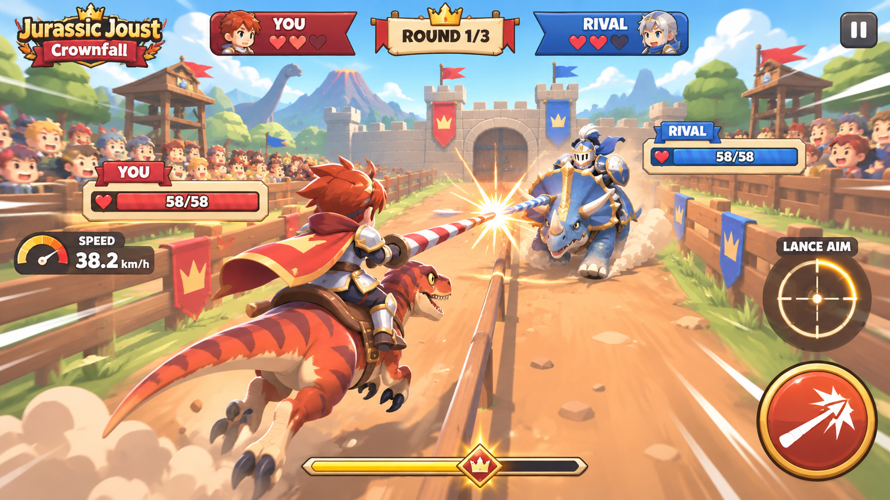
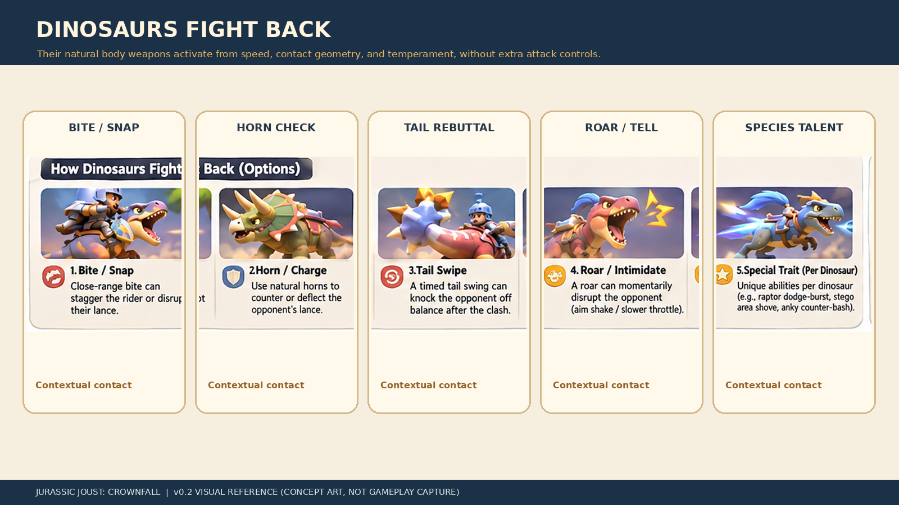
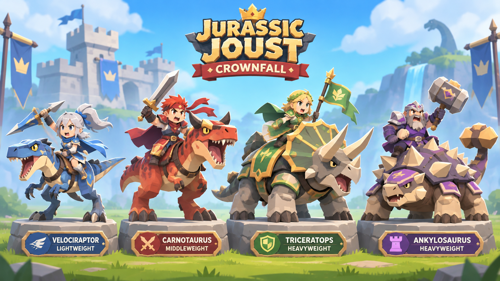
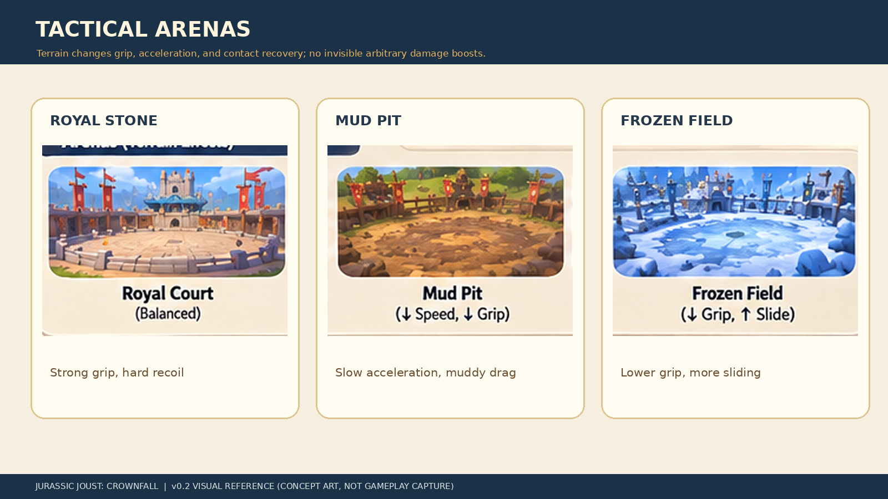
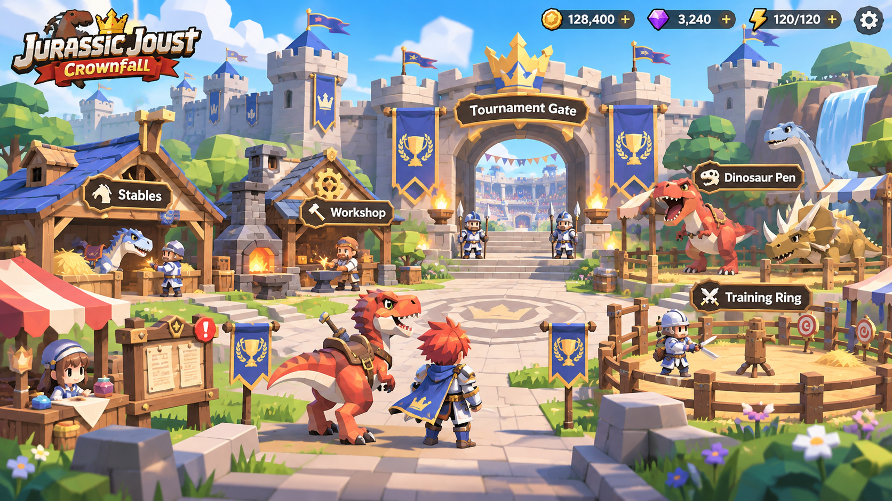
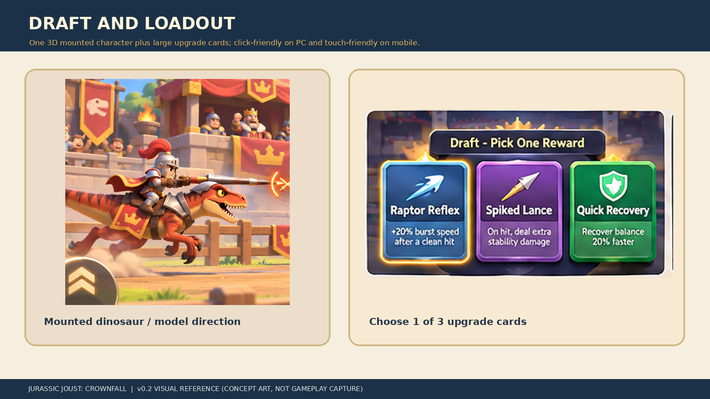
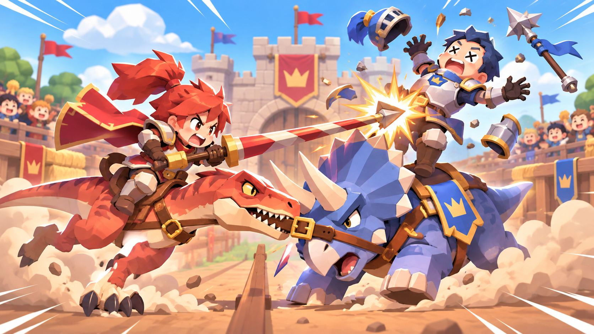

# JURASSIC JOUST: CROWNFALL
## Game Design Document — v0.3 | Canonical handoff | 18 November 2026

**Platforms:** Windows PC + iOS/Android phones in LANDSCAPE mode. **Engine candidate:** Unity URP (PROPOSED, not approved; evaluate Godot 4 or Unreal against PC + mobile landscape). **Rendering:** genuine real-time 3D environments, characters, animation, and contact. **Core interaction:** throttle + aim/release lance. **Genre:** bite-sized action-sports jousting + roguelite draft + tournament campaign.

> **Status convention:** LOCKED = user requirement or strong implementation baseline; PROPOSED = recommendation requiring review; EXPERIMENT = must be tested in prototype. All numbers are initial balance assumptions, not final game facts.

> **LATEST DECISIONS OVERRIDE v0.2:** Live combat camera is **behind and above the rider looking forward along the jousting lanes**, not the old sideline camera. The current art is **faceted chibi-anime fantasy 3D**, not the softer Kingshot-like/rounded toy look. The prior documents and images are archived for history. The current images are conceptual art, not engine screenshots or rigged 3D assets.

## 0. Creative brief and decision register

**One-sentence pitch:** Ride a stylized dinosaur into short, spectacular medieval jousts where the knight's lance and the dinosaur's natural weapons both determine who stays in the saddle.

| Decision | Status | Implementation interpretation |
|---|---|---|
| True real-time 3D | LOCKED | 3D meshes, rigged dinosaurs/riders, physically staged arena, real shadows/lighting; not 2D sprites or cardboard layers |
| PC + mobile landscape | LOCKED | One shared game, responsive 16:9 through 20:9 landscape layouts, keyboard/mouse and touch |
| Faceted chibi-anime fantasy 3D art | LOCKED | Original low-to-mid poly, angular/beveled shapes, illustrated materials, expressive chibi riders, recognizable dinosaur silhouettes; easy asset reuse, never copy existing game characters |
| Dinosaur fights too | LOCKED | Dinosaur-specific body contact attacks integrated into jousting; no dinosaur as passive speed stat |
| Two control families in match | LOCKED | Throttle and lance aim/release; dinosaur techniques trigger contextually; no mandatory bite button |
| Weight/division-based fair matchmaking | LOCKED | Normal tournaments enforce mass AND saddle-height limits; no baby raptor versus full T. rex |
| Terrain changes strategy | LOCKED | Grip, acceleration, recoil, and animal technique windows react to arena conditions |
| Multiple game modes | LOCKED | Campaign, Challenge, Draft, Endless, Exhibition; one shared duel simulation and chase camera |
| Guaranteed winning chances | PROPOSED | Each standard match has a learnable, skill-based path to win; no hidden rubber-banding |
| Deterministic combat + lively physical reactions | PROPOSED | Fixed-step outcome model, exaggerated but non-authoritative hit reactions |
| Open jousting corridor | PROPOSED | No central full-height barrier: overlapping natural weapons can contact opposing dinosaur |
| Live joust rear chase camera | LOCKED | Behind/above player rider, directed down the lane, central clear impact zone; impact and follow-through cameras only when timing-safe |
| Detachable gear / head / limbs | BACKLOG | Experimental, cartoon non-gory slapstick effects; not a finalized MVP system |
| Optional Beast Stance choice | EXPERIMENT | Pre-pass stance only if the initial 2-input combat lacks decision depth |

### Non-goals for the first release

No open-world riding, free-steering combat, breeding simulation, online ranked PvP, full-body physically simulated dinosaur locomotion, gore, or dozens of species at launch. A sprawling castle hub is not required for the MVP: it is an interactive 3D diorama and menu rather than a walking simulator.

## 1. Product vision and player experience

### 1.1 Design pillars

1. **Master in a minute, improve for hours:** The first joust is playable with two controls; mastery comes from reading opponents, speed choice, aiming, and species matchup.
2. **Two fighters per team:** Knights use lances; dinosaurs use horns, jaws, shoulders, tails, and temperaments. Both are visibly relevant.
3. **Every dinosaur has a reason to exist:** Different hit geometry, movement curves, technique windows, weaknesses, and preferred terrain.
4. **Clear before clever:** A player understands a loss from visible strike lines, impact feedback, and a replayable result breakdown.
5. **Physics is the punchline, not the referee:** Dramatic knock-offs, bent lances, dust, comic stumbles, but stable simulation rules.
6. **Replayability by tactical variety:** Draft choices, arena conditions, opponents, and equipment create new decisions rather than pure numerical inflation.

### 1.2 Audience and sessions

Accessible to players aged approximately 10+ who enjoy short competitive games, 3D creature characters, slapstick physics, boss duels, and compact roguelites. **Target:** a jousting pass of about 8–18 seconds, an encounter of 30–90 seconds depending on passes, and a Draft run of about 10–20 minutes. These are playtest targets.

### 1.3 Fantasy and tone

An absurd but internally believable kingdom has turned medieval jousting into the world's grandest dinosaur sport. Competitive stakes are sincere; animation and spectators are humorous. No gore or realistic injuries. Dinosaurs are spirited athletic partners, not expendable monsters.

## 2. Game loop and contest rules

### 2.1 From menu to reward

1. Inspect opponent, division, arena, and weather; choose a legal mount and gear.
2. Enter a 3D arena. A short readable intro reveals opponent species and its visible signature technique.
3. Perform a joust pass: throttle, aim and commit lance, resolve rider strike and beast contact, witness physics reaction.
4. If neither rider falls, reset to starting lines and repeat, carrying over appropriate stability strain.
5. Resolve match after a maximum of three ordinary passes. Choose loot, improve loadout, and take the next tournament branch.

### 2.2 Victory, defeat, and scoring

**Primary win:** Knock the opposing rider out of the saddle. **Secondary win if three passes end without knock-off:** Higher accumulated **lance strike points** wins; beast contact affects stability and creates openings but does not automatically award independent points under the current recommended standard rules (PROPOSED pending tests). **Tie:** one sudden-death pass, after which the higher stability remaining wins if still tied. **Defeat:** player unseated, or opponent wins on points. No health bar combat and no dinosaur death.

### 2.3 Arena layout

Two opposing mounts run on guided, slightly offset 3D corridors. Riders have clear lance reach; the open inner space also allows snout, frill, shoulder, and post-pass tail contact. Players do not steer; they influence when and how strongly the creatures meet through speed. The arena must be wide enough for both mounts and clear silhouette overlap at mobile resolutions.

## 3. In-match controls and combat timing

### 3.1 Two control families

| Input | PC keyboard + mouse | Mobile landscape | Meaning |
|---|---|---|---|
| Throttle | Hold Space | Hold left thumb throttle pad | Accelerate; release to coast and drag down to species/terrain baseline speed |
| Aim lance | Mouse button hold, drag vertically | Touch and drag right-side lance zone | Set angle from low to high; live projected reach indicator |
| Commit lance | Release mouse button | Lift right thumb | Lock angle; brief wind-up creates contact window; recover if no hit |

**Gamepad option (post-MVP):** right trigger = throttle; right-stick vertical aims; stick-click or face-button commits. It remains the same two control systems, even if the physical mapping differs.

The player can change throttle while aiming. The lance cannot be instantly retargeted during its final commitment window (initial target 0.3–0.5 s, to tune). Aim assist is mild and communicated in accessibility settings, never hidden enough to turn a miss into a clean hit.

### 3.2 Pass state machine

| State | Length target | Player can do | Simulation/feedback |
|---|---|---|---|
| Start & read | 2–4 s | See rival, terrain, tell | Brief establishing shot then stable behind-rider chase camera |
| Charge | 4–10 s | Throttle, aim | Terrain grip, acceleration, opponent behavior |
| Commit | 0.3–0.5 s | Throttle continues; no re-aim | Lance contact shape extended; telegraph stays readable |
| Contact | 0.15–0.45 s | No extra input | Simultaneously evaluate rider lance and dinosaur contact |
| Recovery | 1–3 s | Watch feedback | Stability update, rider stumble, dinosaur recoil, particles |
| Reset / result | 1–3 s | Next pass or reward | Simple scoreboard, no excessive animation wait |

### 3.3 Three strike grades

- **Clean:** contact near the valid saddle/rider zone with favorable angle and timing; visible gold spark and stronger stability damage.
- **Glancing:** lance catches armor/shield or leverage is poor; scrape sound and smaller stagger.
- **Miss:** lance does not connect; clear whiff sound, no arbitrary damage. The dinosaur may still make a legitimate body contact independently.

The rider never has to control the dinosaur's jaw, horns, or tail with another button. The creature's techniques come from its position, speed, and behavior.

## 4. Dinosaurs are combatants: evaluated design options

| Approach | Mechanic | Benefit | Cost / risk | Verdict |
|---|---|---|---|---|
| Natural-weapon contacts | Species-specific horn, bite, shoulder, tail collision windows | Clear identity; intuitively physical | Needs hit geometry and anim timing | MVP YES |
| Contextual triggered techniques | Auto trigger when distance/speed/stance condition met | Preserves two controls; feels responsive | Can feel random without readable tells | MVP YES |
| Combat temperament | Aggressive, wary, stubborn responses alter trigger thresholds and stability tendencies | Personality and draft variety | Must not introduce hidden hit chance | MVP LIGHT |
| Pre-pass Beast Stance | Choose Charge / Brace / Counter before each pass | Adds tactics without match-time controls | More menu friction and AI tuning | LATER TEST |
| Beast Clash interlude | Short shove/grapple when creatures meet | Spectacle; differentiates the IP | Can obscure a clean jousting result | MVP SHORT REACTION |
| Post-dismount rescue | Dino can temporarily keep fighting after rider falls | Comic comeback opportunity | Undermines clear win condition | EXHIBITION ONLY / MAYBE |

### 4.1 Recommended MVP: Contact Instinct

Every species has **one innate technique** with: explicit activation geometry, a minimum/maximum useful closing speed, a telegraph, one attempt per pass or defined cooldown, a primary stability effect, and a weakness. It activates automatically when conditions are met. The player's throttle changes contact speed and timing; lance aim and commitment can leave the rider more or less well braced when the creatures clash.

**Examples:**

- **Raptor Snap (close pass):** The raptor can briefly nip at the opponent's shoulder after a low-speed near-pass. More reliable at moderate speed; loses to horn-first contact and wide spacing.
- **Triceratops Horn Check (front contact):** At controlled medium speed, horn/frill contact briefly shoves the opposing mount and destabilizes its rider. Vulnerable to precise high lance strikes and aggressive over-speeding.
- **Ankylosaurus Tail Rebuttal (post-pass):** After surviving a close pass, a short follow-through tail swing can create a secondary stagger if the opponent remains within the rear-side arc. Cannot initiate before crossing.
- **Carnotaurus Shoulder Rush (crossing):** Higher-speed shoulder contact pushes the rival laterally, but a miss increases its own recoil.
- **Pachycephalosaurus Headbutt (front contact):** Short-range head strike in the appropriate height zone; strong on narrow targets, risky against longer horns.

### 4.2 Beast Clash camera and limits

Beast Clash occurs within the same jousting pass, **not** a new minigame. When bodies touch, play a <=0.75-second contextual pair animation (horn lock, shoulder bounce, snap, tail follow-through), possibly a very brief hit-stop. The visual must match the already computed outcome. No additional QTE, surprise attack button, or untelegraphed free damage. If both dinosaur attacks connect, both can suffer recoil and stability effects.

### 4.3 Signaling and counterplay

A creature lifts its head, braces feet, lowers horns, or winds its tail before the active window. Distinct audio cues and a subtle species icon reinforce the cue. Counterplay includes changing speed, using lance height to target exposed rider regions, and choosing a dinosaur whose body profile avoids the opponent's strongest contact range. Arena terrain can disrupt or strengthen specific techniques through traction, never through invisible dice rolls.

## 5. Collision, stability, and fun physics

### 5.1 Authoritative 3D collision model

Use simplified 3D collision proxies (capsules/boxes/convexes) attached to bone transforms: lance head/shaft, rider torso, shield, saddle, dinosaur head/horns, shoulder, flanks, and tail segment when relevant. At a **fixed simulation timestep**, sample position, velocity, stance, and hit normal. The scoring system uses these stable proxies rather than GPU particle systems or ragdoll joint luck.

**Suggested model (placeholder, tunable):**

- Closing speed = relative approach velocity along jousting axis.
- Impact impulse estimate = reduced mass x closing speed x contact alignment; clamp to division-specific safe scale.
- Rider destabilization = lance contact quality x leverage x impulse + innate beast contact contribution - shield/saddle/brace mitigation.
- Grip and terrain determine acceleration and resistance to slip; body recoil also feeds into rider stability.
- Rider is unseated when accumulated destabilization exceeds the stability reserve; partial strain may persist between passes.
- Resolve simultaneous lance and beast contact using the same timestamp/contact window before awarding a result. One animation cannot erase a valid simultaneous strike.

All multipliers and thresholds live in data assets, not hard-coded species branches.

### 5.2 Fun-physics layer (visual only)

Once the win/score result is decided, launch stylized ragdoll rider reactions, bend/break lance props, nudge dinosaur rigs, kick up chunky dust decals, and bounce harmless armor pieces. Small mounts visibly skid; heavy ones do an exaggerated shoulder roll. Snap back to a stable pose before another pass. Physics random seeds may vary tumble direction, **not who wins**. The creature should not ragdoll into impossible anatomical shapes.

### 5.3 Readable replay

Decisive hits may trigger a 0.5–1.2-second replay with slight zoom, short hit-stop (30–80 ms), and the two causes labelled **Lance / Beast**. Replay is skippable and can be disabled on mobile. No camera shake that obscures precision during active aim; any cinematic camera cut occurs only after input commitment or combat outcome.

### 5.4 Fairness and anti-frustration

Normal matchmaking must pass both mass and rider-seat-height bounds. In ordinary encounters, every legal mount/opponent matchup must have at least one practical tactical counter supported by collision geometry. No secret catch-up damage, invisible invulnerability, or scripted miss. Some matchups are harder by design; Campaign can grant retries and practice. Exhibition can ignore class limits with an explicit warning that balance is not guaranteed.

## 6. Dinosaur roster and divisions

### 6.1 Tournament sizing

These are **fantasy, tournament-bred, rideable interpretations** of recognizable species, not literal paleontological scale. To preserve species identity: retain distinctive head shapes, body posture, tail length, plates/frill, and characteristic gait. Do not turn every dinosaur into a similar stocky lizard. Internal mass values are gameplay normalized, but visible body footprint still matches expected class.

**Division eligibility proposal:** every creature carries `(mass_index, saddle_height_index, length_index)` and a registered division. A normal matchup requires the same registered division and a maximum pre-tune mass ratio about 1.35 plus saddle-height ratio about 1.30. An adjacent-class exhibition or special event requires explicit rule overrides. No ordinary raptor-versus-T. rex.

| Division | Recognizable example species | Common combat identity |
|---|---|---|
| LIGHT | Enlarged Velociraptor, Protoceratops, Pachycephalosaurus, Gallimimus | Acceleration, low profile, narrow contact timing |
| MIDDLE | Utahraptor, Carnotaurus, Parasaurolophus, Corythosaurus | Burst speed, versatility, shoulder/body counterplay |
| HEAVY | Triceratops, Ankylosaurus, Stegosaurus, T. rex | Mass, bracing, wide body weapons, slower turns of momentum |

Species assignments are provisional; silhouette and usable mass bands take precedence over literal real-world weights. T. rex and Ankylosaurus are separate playstyles despite sharing a tournament division.

### 6.2 Core dinosaur data schema

`species_id`, `division`, `mass_index`, `saddle_height`, `body_length`, `accelerate_curve`, `top_speed`, `traction`, `balance`, `recoil_resist`, `temperament`, `signature_contact`, `valid_contact_geometry`, `telegraph_anim`, `cooldown_passes`, `favored_terrain`, `weak_terrain`, `lod_meshes`, `anim_set`, `audio_set`.

### 6.3 Identity and matchup examples

| Species | Strength | Weakness | Unique natural attack |
|---|---|---|---|
| Velociraptor (Light) | Quick speed changes, low rider profile | Low mass and contact tolerance | Raptor Snap after near-pass |
| Protoceratops (Light) | Strong brace and short-horn interception | Limited sprint | Frill Guard + Nose Nudge |
| Pachycephalosaurus (Light) | Strong burst at short contact gap | Very narrow attack window | Dome Headbutt |
| Carnotaurus (Middle) | Late sprint and shoulder reach | Overrun/recoil risk | Shoulder Rush |
| Parasaurolophus (Middle) | Stable speed, long gait, sustained momentum | Weak direct head weapon | Body Feint/Lean |
| Triceratops (Heavy) | Front stability, head-on counter | Large target, modest acceleration | Horn Check |
| Ankylosaurus (Heavy) | Defensive recovery, low center of mass | Low top speed, tail timing | Tail Rebuttal |
| T. rex (Heavy) | Intimidating bite and high impact mass | High saddle profile and slower control response | Powerful short-range Bite Check |

The MVP implements **three Light mounts** and their authentic-looking silhouettes; larger classes are roadmap content, not required to validate the core duel.

## 7. Arenas, terrain, and conditions

Terrain affects actual motion and collision, not arbitrary damage bonuses. Each arena has **one dominant property**, and optionally **one clearly signaled weather condition**. Players can scout the arena before locking their mount.

| Arena | Dominant physics behavior | Tactical expression | Readable visual treatment |
|---|---|---|---|
| Royal Stone Court | High grip and strong hard-surface recoil | Powerful late attacks; overcommit is dangerous | Clean tan stones, gold/red banners |
| Mud Pit | Heavy mounts accelerate slowly and slide less predictably | Establish speed early; grip specialists gain value | Brown mud strips, soft chunky splashes |
| Sunscorched Sands | Low traction during rapid speed changes | Smooth throttle management beats late sprint | Yellow-orange dunes, heat tint |
| Frozen Grounds | Poor lateral grip and slower recovery after stumble | Controlled approach, avoid wild commitments | Blue ice patches, clean slide streaks |
| Tall Grass Field (post-MVP) | Low visual body cues in grass; no hidden lance target | Read opponent posture rather than feet | Green swaying grass, strong silhouette contrast |

**Weather:** rain amplifies wet traction penalties; wind minimally shifts the lance's cosmetic sway but must never make aiming random; snowfall changes visual atmosphere before introducing new physics. Never stack more than two impactful modifiers in an ordinary duel.

## 8. Modes: structure and camera rules

### 8.1 Shared fundamental rule

**Every actual duel in every mode uses the same 3D jousting camera and combat mechanics.** Modes change stakes, opponents, rewards, and pre-/post-match presentation, not controls or hit physics. This prevents five divergent combat implementations.

| Mode | Player experience | Pre/post match camera | Actual duel camera |
|---|---|---|---|
| CAMPAIGN | Unlock regional leagues, rivals, weight divisions, narrative championships; retry losses | Fixed high three-quarter **interactive 3D courtyard diorama**; select Stable, Tournament Gate, Workshop via clicks/taps | Shared 3D rear three-quarter chase camera |
| CHALLENGE | Hand-authored skill puzzles: low-speed win, survive horn check, precision timing | 3D miniature **challenge podium** with animated opponent and arena preview, fixed orbit | Shared 3D chase camera; optional training overlays |
| DRAFT | 6–10 encounters; choose mount, gear and route, gain build cards; a lost run ends | **3D model turntable** behind 2D cards; route/map in stylized panels | Shared 3D chase camera; intensity increases with elites/boss |
| ENDLESS | Continuous opponents, scaling AI and terrain variety; highest streak | 3D arena **wide establishing shot** between waves; compact streak HUD | Shared 3D chase camera, alternate lighting/weather only |
| EXHIBITION | Select any species, class override, arena, weather, AI for experiments/fun | **3D showroom turntable** side-by-side of mounted riders, player-adjustable slow orbit | Shared 3D chase camera, optional spectator camera on replay |

**Camera in motion:** A fixed-style, behind-and-slightly-above-rider chase view along the jousting lane. Camera advances with the player, uses modest pitch and side offset for opponent visibility, maintains the target/impact area near screen center, and keeps lance aim readable. It can tighten slightly as impact approaches without changing the mapping between inputs and projected aim. **Do not cut the camera during active aiming or commitment.** A brief contact emphasis after commitment is allowed, and a cinematic follow-through angle is allowed after resolution.

### 8.2 Campaign details

Progress through three regions with themed arenas and rising opponent mastery. The main courtyard is a **true 3D menu hub**, not free-roaming gameplay; camera at about 25–35 degrees above ground, fixed yaw with subtle background parallax. Click or tap destinations. Open stable to see rigged dinosaur idle animations on plinths. Story delivered through brief character encounters and tournament cards. Region bosses teach one counterplay rule each.

### 8.3 Challenge details

Three objective families: aiming (clean high/low strike), throttle (specific speed control), and species mastery (land or defend a beast contact). Challenges show an intro miniature 3D scene in the right-side preview, medals, and conditions. One arena loads when the player starts.

### 8.4 Draft details

Pick a registered weight class and one of three offered dinosaurs. Choose a starting lance, saddle, and one perk. Route selection presents opponent, terrain, and potential reward; choose one branch. Rewards: one of three upgrades. A run contains normal, elite, and boss encounters. Re-roll budget limited. To keep identity, do **not** switch registered division mid-run. Meta unlocks expand item availability but avoid persistent base power overwhelming early rivals.

### 8.5 Endless and Exhibition details

Endless preserves build and mount and ramps opponent strategy, modifiers, and opponent variety rather than multiplying mass without limit. Exhibition permits classic match-ups and imbalance warnings; normal leaderboard submissions require legal divisions. Both return to a stable same-camera duel for matches.

## 9. Art bible: CURRENT faceted chibi-anime fantasy 3D

### 9.1 Locked visual direction

The latest user-approved direction moves **away from both semi-realism and the rounded Kingshot-like toy look** toward an original **faceted, chibi-anime fantasy roster** presentation. The supplied third-party screenshot was a *style reference only*, not an instruction to copy its characters, promotional composition, materials, or branding. Use hard-to-miss silhouettes and bold JRPG-like faction color blocking; keep geometries economical and models reusable across PC and mobile landscape.

**Visual keywords:** low-to-mid poly; angular/beveled planes; simplified hand-painted/gradient color blocks; lively chibi-anime faces and hair; sculpted readable dinosaur bodies; simple shaded metal/leather; dynamic exaggerated poses; bright medieval-fantasy atmosphere; controlled visual noise.

**Anti-targets:** photoreal pores/scales, metal micro-scratches, complex shader graphs, block/voxel dinosaurs, entirely round plush-toy morphology, photoreal gore, full-scale cinematic model budgets, direct copies of third-party characters.

### 9.2 Proportions, silhouette and modular construction

- Riders: stylized chibi-anime proportions ~2.5–3.5 heads tall as a **proposed** art test; expressive faces/hair, simplified articulated hands, wide helmet and weapon silhouettes. Favor wedge/planar hair clumps and faceted armor instead of over-round shapes.
- Dinosaurs: obviously correct *silhouette families* at gameplay distance. Raptor = long tail, bipedal runner legs, long head; ceratopsian = frill/horns/quadruped gait; ankylosaur = low body, plated back and club; stegosaur = upright plates and tail spikes. Fantasy scaling for rideability is acceptable; species identity cannot be sacrificed.
- Geometric language: broad flat planes, selectively beveled edges, 1–2 primary color groups with accent color. Use larger designed armor plates instead of dense engraved filigree.
- Reusable rider skeleton with modular hair/helmet/cape/pauldron/armor; mount skeleton templates by body family plus unique species silhouette meshes and head/tail rigs. Saddle attachment and detachable armor sockets standardized across riders.

### 9.3 Shader, lighting, animation, VFX

- Flat or painted color regions plus restrained directional gradient, AO/contact shadow, minimal texture noise, and stylized specular highlights. Avoid expensive multilayer realism.
- One key sun or directional light, simple sky/ambient fill, baked static geometry where practical. Shadows should support readable feet and contact, not dominate.
- Snappy animation with exaggerated windup/anticipation for horn brace, bite, snap, shoulder rush and tail counter; use broad poses readable in the chase camera at mobile scale.
- Hits use clean starburst, chunky particles, dust, short hit-stop and highly readable knock-off. Ragdoll and detachable *gear* are separate feedback, not scoring. Detachable limbs/head are **BACKLOG**, not canonical MVP and must remain non-gory if tested.
- UI combines bold fantasy tournament panels with functional high-contrast markers; do not cover the lane vanishing point or lance contact zone.

### 9.4 Preliminary mobile geometry and texture budgets (not measurements)

| Asset | First working target | Notes |
|---|---:|---|
| Light mount | ~3k–8k triangles | Species-specific 3D silhouette; LODs after profiling |
| Rider with saddle | ~1.5k–3k triangles | Shared rig, modular kit |
| Heavy mount | ~6k–12k triangles | Later content; screen footprint priority |
| Arena active visible geometry | ~25k–60k triangles | Modular repeated pieces and impostor crowd |
| Hero texture resolution | 512–1024 px per relevant atlas | Shared palettes/materials; check target phone |

Do not treat these as performance guarantees. Measure draw calls, GPU time, skinning, and overdraw on actual hardware.

### 9.5 Production kit and 3D generation workflow

Start with a character style sheet and front/side/back turnarounds, then a small mount family and one standard humanoid rig, standardized bone naming, modular gear, automated material palette changes, and export/prefab validation. AI images and image-to-3D services can accelerate ideation and rough meshes, but output must be cleaned, retopologized, UVed, rigged, scaled, LODed and tested. See `ART_BIBLE.md` and `ASSET_PIPELINE.md`.

**Current concepts:**

## 10. Exact camera and presentation specifications — current lock

### 10.1 Shared LIVE 3D duel camera: rear three-quarter chase

The user supplied a portrait knight-joust reference and explicitly chose **this kind of forward-looking chase camera** for Crownfall combat. Adapt its geometry, not its portrait screen proportions, to **PC and mobile landscape**.

- **View:** third-person perspective behind and slightly above the player's rider/dinosaur, looking forward down a straight pair of guided opposing jousting lanes. Prefer an over-the-shoulder *three-quarter* offset to a straight center view so the player mount does not occlude the lance target.
- **Motion:** follow player forward velocity with damped spring motion; preserve consistent aim-to-screen mapping. Keep horizon stable during player input and introduce only small speed-dependent zoom/FOV. Fences, dirt streaks, footfall dust and crowd parallax give speed cues.
- **Composition:** player dinosaur/rider in the lower foreground, opposing knight/dinosaur in the distant upper-middle and converging toward the central impact corridor; maintain a readable projected lance tip, enemy head/neck and rider upper torso. Allow camera to offset automatically to protect the targeting line.
- **Approach:** no major camera cut, orbit, depth-of-field obscuration, or shake during critical aim/commit. Controlled FOV expansion at speed and short squeeze as enemy approaches are **EXPERIMENTS** that must preserve aim accuracy.
- **Impact:** cue the beast contact and rider strike in a shared temporal window. Once the inputs are locked and the deterministic hit resolution is available, apply optional **micro hit-stop** (~30–80 ms proposal), clear contact burst and a brief controlled reframing that makes lance tip and dinosaur action understandable.
- **Follow-through:** after the verdict, optional short orbit/sideline cut to show rider ragdoll, helmet/lance pieces and victory/recovery; return to chasing camera for next pass. This is the safe place for humorous physical chaos.
- **No active camera ambiguity:** where the chase view cannot make horn/bite/rear tail contact readable, use an animation silhouette cue and a compact rider/beast results banner, or show a skippable alternate replay **after** resolution. Never solve it by moving the live camera behind cover.

**Starting values for prototype, not a lock:** FOV ~55–70° PC (calibrate horizontally and for phone aspect), pitch ~8–18° downward, camera follow damping ~0.10–0.25 s and offset ~0.5–1.5 rider widths. Actual values must be tuned to mount length and screen size. Prioritize outcome clarity over these numbers.

### 10.2 4-phase camera state machine

1. **ChargeChase:** stable forward over-rider lane view, readable opponent and aim controls.
2. **PreImpactFocus:** very restrained center reframe or FOV tighten, no hidden aim mapping change.
3. **ImpactEmphasis:** after commit/contact, brief highlight of rider lance + dino body contact (same simulation verdict).
4. **ResultFollowThrough:** skippable cinematic showing dismount and objects, then reset to ChargeChase.

### 10.3 Pre/post cameras per mode

| Mode or scene | Camera during selection, prep or intermission | Camera in an actual joust |
|---|---|---|
| Campaign | 3D high three-quarter **courtyard diorama** (~25–35° downward pitch); interactive gates/stables/workshop, no free-roaming prerequisite | Shared rear-chase 3D camera |
| Challenge | 3D miniature preview podium of challenge dinosaur and its arena, orbit fixed to readable front 3/4; optional challenge telegraph overlay in match | Shared rear-chase 3D camera |
| Draft | 3D model **turntable/plinth** next to readable upgrade cards and a stylized route map; smooth portrait orbit only on menu | Shared rear-chase 3D camera |
| Endless | Between waves, wide high-angle 3D arena sweep, opponents entering gate; during match retain compact streak overlay | Shared rear-chase 3D camera |
| Exhibition | Dual 3D showroom turntables with size comparison, weather and illegal-division warning; optional extra post-hit replay camera | Shared rear-chase 3D camera |
| Stable / roster | Low front-3/4 3D model turntable with user rotate, fit entire dinosaur in safe frame | Not applicable |
| Win/loss replay | Brief side or front close-up **only after** the actual decision, reduced-motion/skippable | Transition back to shared rear-chase on retry |

### 10.4 Landscape framing and safe areas

Design logical layouts first at 16:9 and test 18:9–20:9 landscape phone viewports. Keep dynamic background crop at edges. Reserve lower-left for throttle, lower-right for lance gesture, top corners for player/opponent stability, top center for score and pass; keep the center near the approaching enemy and lance tip unobstructed. Mobile thumb targets ~64–80 logical px equivalent before density tuning. Aim angle needs a clear 2D arc cue tied to the real 3D lane.

**Visual references (concept only):**

## 11. Platform UX, mobile landscape, and accessibility

### 11.1 Single design, responsive landscape

Primary layout designed at 1920x1080 logical reference (16:9), adapting down to 1280x720 and wider landscape phones (up to roughly 20:9). No portrait gameplay. Mobile uses responsive UI anchors and safe-area insets for notches/cutouts. The play field maintains a central contact-safe rectangle; decorative crowds/backgrounds crop first at wide aspect ratios.

### 11.2 Input zones

- **PC:** Space throttle, mouse hold/vertical drag/release for lance. Mouse wheel does not change the live camera. ESC pauses. Optional hold-to-aim preview can be remapped.
- **Mobile:** left lower corner a large throttle hold area; right lower corner a large vertical drag/aim region with a visible lance height indicator. Controls partially transparent and at least ~64–80 logical px equivalent minimum touch target, adjusted to actual mobile DPI.
- **Menu:** obvious large 3D hotspots backed by flat interface labels. No text tiny enough to require zooming. Pause and accessibility accessible outside thumb zones.
- **Feedback:** haptic pulse on hit where supported, subtle screen shake toggle, colorblind-friendly faction silhouettes/symbols, text size scaling, reduced-motion option, 30 FPS performance mode.

### 11.3 Onscreen information hierarchy

Top left player rider stability; top right opponent stability; center top pass counter and score; lower left speed gauge; lower right lance height/release feedback; short telegraph icon near enemy for active species technique. Camera must reveal both riders' upper bodies and most dinosaur silhouettes at all times. Avoid bloated HUDs or covering the jousting corridor.

## 12. Upgrades, economy, and progression

### 12.1 Three loadout slots in a run

**Lance** controls angle/speed/contact behavior (long reach, heavy impact, spring rebound). **Saddle/Armor** controls survival and recovery (brace, recoil absorption). **Perk** changes playstyle (low-profile specialist, last-second sprint, beast-contact focus). Dinosaurs have innate techniques that are never replaced by generic weapons. Items may modify trigger thresholds, not erase species identity.

| Sample item | Rules-level effect | Player-facing change |
|---|---|---|
| Spring Lance | Converts a fraction of clean hit impulse into extra unseat leverage; weaker on glance | Precise strikes pop riders upward |
| Reinforced Saddle | Reduces first major stagger per match; slightly lowers acceleration | Defensive, patient play |
| Quickstep Harness | Better deceleration and re-acceleration; less recoil protection | Responsive timing |
| Beast Handler | Shows the innate-contact window earlier; modest consistency boost | Learn dinosaur-specific technique |
| Splinter Lance | Breaks on strong clean contact for bonus score, cannot score again this pass | High commitment big hit |
| Underdog Crest | Bonus leverage versus taller **legal same-division** mount | Rewards low-profile matchups |

### 12.2 Campaign and Draft unlocks

Campaign unlocks regions, species, gear families, arenas, and challenges. Draft is replayable with randomized choices from the current legal unlock pool. Meta progression is breadth-first: unlocking more options, cosmetic crests, tournament history, and characters; minimal permanent combat power. Cosmetic purchases, if ever considered, must not introduce pay-to-win progression.

## 13. AI opponents and match readability

AI uses five readable approaches: **Sprinter** (late acceleration), **Sniper** (precise high lane), **Counterpuncher** (controlled speed, beast contact), **Brawler** (leans on body impact), and **Feinter** (variable throttle). Bosses combine two behaviors and one visible signature, but obey the same controls and collision rules. AI gets no forbidden mass, invisible shield, or hidden aim bonus. Telegraphed mistakes are acceptable at beginner level; expert opponents respond to player habits with fair cues.

**Match result overlay:** show `Lance: Clean / Glance / Miss`, `Beast: Horn Check / Bite / No Contact`, `Momentum: Low / Optimal / Overcommitted`, and `Stability: +/-`. This is a learning tool as well as feedback.

## 14. Implementation architecture

### 14.1 Gameplay modules

- `MatchFlow`: divisions, AI setup, duel-pass state machine, scoreboard, retries, win condition.
- `DinoMotion`: 1D guided lane locomotion in a 3D environment, per-species acceleration/traction curve, terrain modifier.
- `LanceAim`: input mapping, world-space angle constraints, aim line and commitment window.
- `ContactResolver`: physics proxy overlap/timing, lance contact quality, natural-weapon trigger, simultaneous contact, deterministic stability damage.
- `RiderStability`: accumulated strain, mount/rider knock-off threshold, saddle mitigation.
- `DinoInstinct`: per-species state machine, tells, attack window, cooldown/behavior.
- `ReactionDirector`: non-authoritative rider ragdoll, procedural recoil, lance fracture VFX, replay.
- `CameraDirector`: shared live camera, pre/post mode cameras, mobile-safe composition.
- `ContentData`: dinosaur, arena, equipment, AI, mode, difficulty, localization config.
- `Telemetry`: capture per-pass velocity, aim, contact pairs, stability delta, result and replay seed.

### 14.2 Determinism and tooling

Use a fixed 60 Hz gameplay step where feasible. Offline single-player scoring should be stable independent of render frame rate. Serialize a duel record `(seed, species, modifiers, input sample stream, contact data)` to reproduce suspicious matches. Build an in-editor collision gizmo to display valid horn/jaw/lance/saddle windows and a balance simulator to batch-check matchups.

### 14.3 PC and mobile performance targets

**PC:** 60 FPS target at 1080p on mainstream hardware. **Mobile:** stable 30 FPS baseline and optional 60 FPS on stronger devices at native landscape orientation; lower particle count/shadow quality/crowds as required. Hard cap active ragdolls and debris. Pool VFX, bake static environment lighting where practical, use LOD and occlusion culling only where safe, and profile on real low-to-mid-range Android hardware. No promise that every phone supports the same visual preset.

## 15. First playable MVP and success criteria

### 15.1 MVP content (one vertical slice)

| Element | MVP scope |
|---|---|
| Tech | Real-time 3D Unity URP or equivalent with PC + Android landscape build |
| Combat inputs | Throttle + lance drag/release; keyboard/mouse and touch |
| Dinosaurs | 3 Light mounts: Velociraptor, Protoceratops, Pachycephalosaurus |
| Innate attack | 1 distinct contextual natural weapon action per mount |
| Arenas | Royal Stone Court and Mud Pit |
| Opponents | 4 standard behaviors, 1 elite, 1 boss |
| Equipment | 8 items across lance, saddle, and perk |
| Modes | One 6-encounter mini Draft; basic Exhibition for testing |
| Physics | 3D hit zones, stable contact scoring, dismount ragdoll, short beast clash reactions |
| Cameras | Shared behind-rider chase camera, post-hit follow-through, 3D roster turntable, Draft choice plinth |
| UI | PC + mobile landscape HUD, pause, result breakdown, quality toggle |

### 15.2 Playtest gates

1. New player can perform one legitimate clean lance hit after a short tutorial without reading a manual.
2. Players can consistently explain *why* they won or lost using visual feedback and results.
3. Every MVP species has a statistically meaningful tactical strength in at least one opponent/arena pairing and no automatic universal dominance.
4. Each arena causes observable throttle strategy changes in tester sessions.
5. Natural weapon contact is readable, avoidable/counterable, and does not feel like random damage.
6. Mobile control zones do not cover the impact moment in 16:9 or wide landscape.
7. Combat scoring matches offline replay logs despite inconsistent graphics FPS.
8. Users voluntarily replay matches after experiencing their first loss; a qualitative desirability gate rather than a made-up guaranteed retention metric.

### 15.3 Build roadmap (order, not dates)

**Milestone A – Graybox physics:** 3D capsule dinos; full throttle, aim, encounter, chase camera, collision, outcome log; single flat arena. **Milestone B – Combat identity:** 3 original species silhouettes/rigs in faceted chibi style, natural weapon windows and telegraphs, impact reactions. **Milestone C – Mobile:** landscape HUD, touch input, chase-camera safe areas, FPS profiling on an actual device. **Milestone D – Content slice:** mud arena, 6-opponent Draft bracket, 8 items, boss, basic upgrade screens. **Milestone E – Feel/polish:** sound, spectator VFX, art kit, accessibility, telemetry, onboarding. **Milestone F – Expanded modes:** campaign hub and world structure, challenge packs, endless, exhibition options, remaining weight classes.

## 16. Risks, unresolved questions, and review checklist

### 16.1 Risks to watch

- **Automatic dinosaur attack feels unfair:** Require tells, cooldown, defined ranges, and a result breakdown.
- **Too much animation hides the joust:** Freeze live camera movement in final contact window; shorten beast reactions.
- **Simplified 3D makes all dinosaurs look alike:** Approve silhouette sheets before texturing or equipment art.
- **Big dinosaurs mismatch smaller mobile framing:** Strict class sizes; per-class framing presets; avoid cross-division normal play.
- **Mobile touch imprecision:** Adjustable drag sensitivity, forgiving preview, clearly visible aim lane.
- **Feature sprawl:** Keep Campaign hub as diorama; launch with Draft + Exhibition mechanics first.

### 16.2 Decisions for review

1. **Engine selection (OPEN):** Unity URP is a recommendation, not a lock. Benchmark or confirm tool familiarity and target device before scaffolding engine code.
2. **Exact scoring (PROPOSED):** 1 point glancing lance, 2 clean, immediate win on dismount; normal dinosaur contacts modify stability but do not independently score. Validate by testing.
3. **Camera follow behavior (EXPERIMENT):** tune chase height, FOV, FOV-at-speed, slight shoulder offset, aim visualization and post-contact reframe on actual landscape viewports.
4. **How much beast damage (EXPERIMENT):** test an initial cap around ~15–20% rider stability per ordinary contact pass; do not turn beasts into random auto-wins.
5. **Beast Stance (BACKLOG/EXPERIMENT):** only add pre-pass tactical stance if two controls plus species identity do not produce sufficient depth.
6. **Chibi model proportions (PROPOSED):** determine whether 2.5, 3.0 or 3.5 head-tall riders remain readable behind the mount in the chase view.
7. **Ragdoll and detachment (BACKLOG):** weapon/helmet/armor detaches are promising; detachable heads/limbs need a separate tone/safety/playability evaluation and are not approved for MVP.
8. **Campaign hub navigation (PROPOSED):** start with clickable 3D diorama to avoid unwanted open-world scope.
9. **Divisions (PROPOSED):** prototype only Light division first; fill out Middle/Heavy after the physics model has proven fair.

## 17. Visual reference inventory and evidence boundary

The following are **AI-generated concept illustrations**, not engine frames, meshes, or confirmed performance results. Text, labels, class markings, or mechanics depicted in AI art are decorative and may conflict with this GDD; the text rules override images.

| Artifact | Role | Current? |
|---|---|---|
| `assets/concepts/current/01_joust_chase_camera.png` | Rear-chase joust framing / landscape HUD | YES |
| `assets/concepts/current/02_rider_dino_impact.png` | Lance + beast contact, gear loss, comic rider knock-off | YES |
| `assets/concepts/current/03_tournament_hub.png` | High 3/4 3D campaign courtyard and interactable buildings | YES |
| `assets/concepts/current/04_mount_rider_roster.png` | Faceted chibi knight/dinosaur silhouettes and palette | YES |
| `assets/animation/01_early_beast_lance_duel.gif` | Historical animation pitch for combined beast/lance combat | EARLY STYLE |
| `assets/concepts/archive_kingshot/` | Earlier rounded toy-like 3D reference pack | ARCHIVE |
| `assets/concepts/archive_early/` | Earlier semi-real/board-style presentation concepts | ARCHIVE |
| Supplied screenshots of existing games / ads | Inspirations for camera and stylization only, not redistributed | EXTERNAL (notes only) |

## 18. Ideas backlog (NOT locked design)

- **Ragdoll physics:** bigger airborne flips, comic falls, stumbles, haystack/environment bounces.
- **Detachable gear:** lance shafts, shields, helmets, armor plates, saddlebags and debris. Could become tactical equipment damage in later prototypes, but not automatic feature approval.
- **Detachable heads / limbs:** suggested as a potential cartoon slapstick idea; must be evaluated against art tone, audience, age-rating, technical scope and whether a non-gory toy-like approach is genuinely fun. Not a launch requirement.
- **Physics chain reaction props:** scattered armor and projectiles may interact with breakable arena props only in visual/replay layer unless a documented rule makes them gameplay-relevant.
- **Beast Stance, Exhibition size-mismatch and post-dismount creature activity:** deferred experiments, require separate sign-off.

Keep brainstorm notes in `../ideas/IDEA_BACKLOG.md`, not in the implementation backlog until approved.

## 19. Implementation confidence and pending tests

- **Verified in source material:** design decisions, user preferences, generated reference images, historical GDD.
- **Not yet verified:** playable feel, camera input mapping, contact readability, balanced mass/height caps, physics stability, reliable AI, real-phone frame rate, rig/mesh usability.
- **Next acceptance gate:** one reproducible true-3D graybox joust with visible chase camera, two controls, rider contact, dinosaur contact event, stable result and debug explanation.

**END — v0.3 CANONICAL HANDOFF**
